# PAPERDOOR · 페이퍼도어

> 다섯 개의 문 — 종이 책 속 다섯 방을 탈출하는 손그림 방탈출 
>
> 👉 플레이: https://jbhee7777-afk.github.io/paperdoor/

관찰, 아이템 조합, 넌센스로 탈출하는 손그림 포인트 앤 클릭 방탈출 게임입니다.
퍼즐 난이도는 초등학생 기준이고, 그래픽은 스팀 인디 게임 수준을 목표로 합니다.

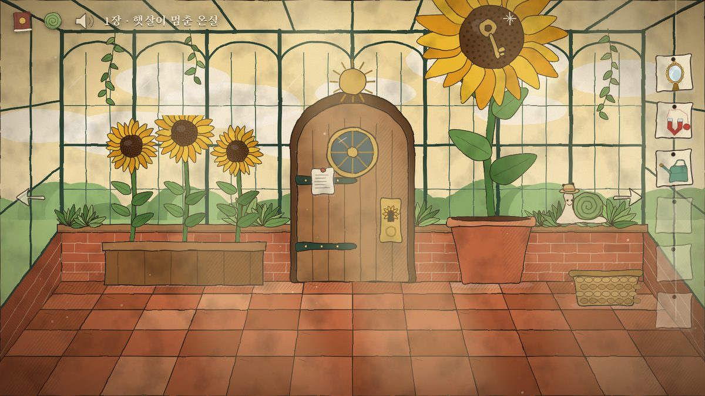

| 잠든 온실 | 거울로 읽는 숫자 | 해님이 깨어나면 |
|---|---|---|
| 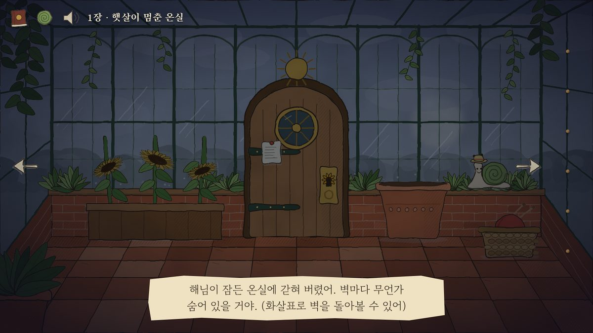 | 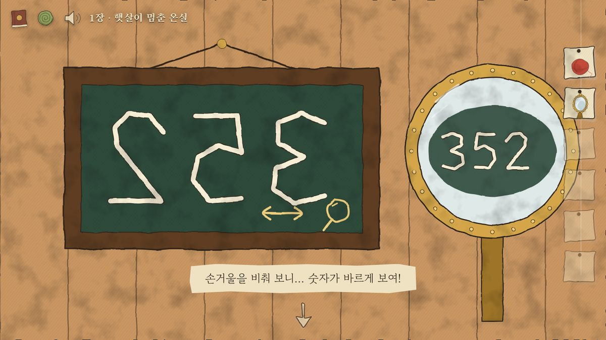 | 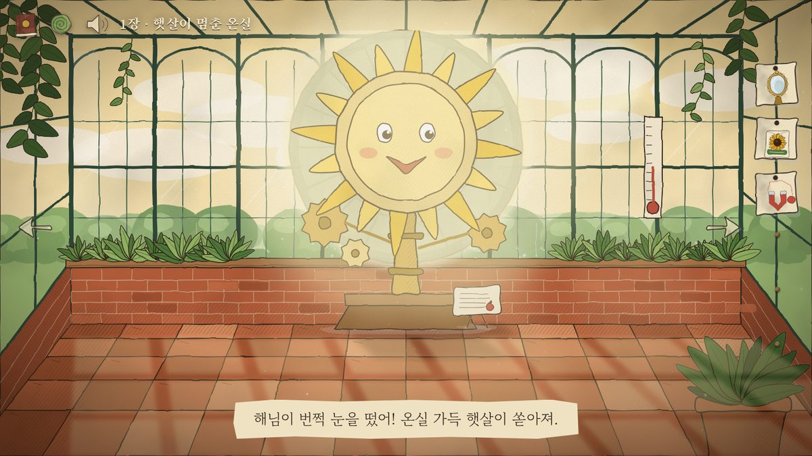 |

**2장 토끼의 장난감 공방**

| 낮잠 자는 모카 | 그림자 인형극 | 오르골 원통 | 깨어난 모카 |
|---|---|---|---|
| 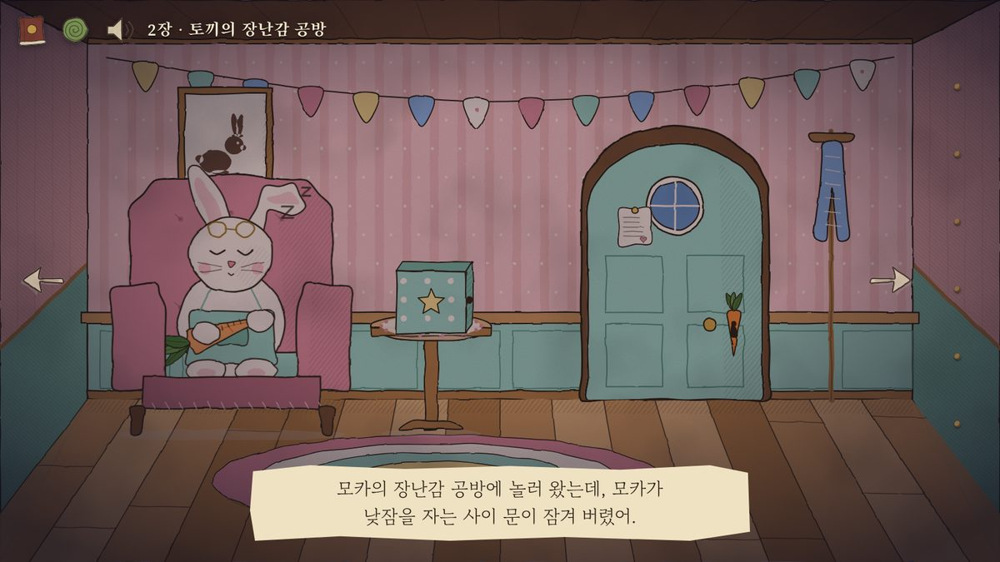 | 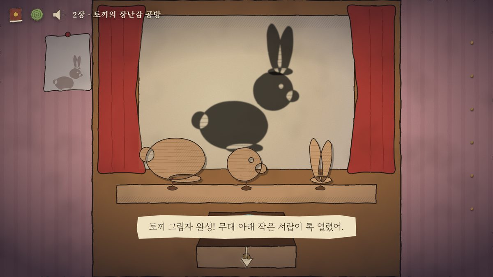 | 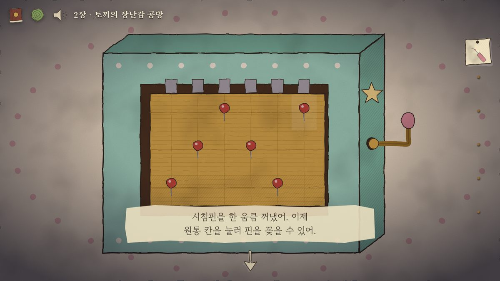 | 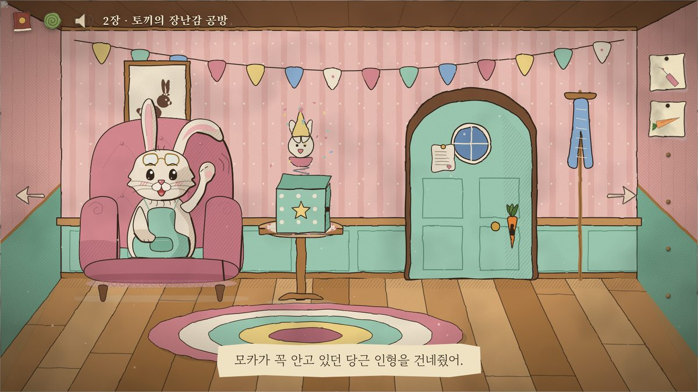 |

**3장 열세 번째 시계**

| 잠긴 다락방 | 달빛과 야광 글씨 | 거울 속 시계 | 그림자 유령 똑딱이 |
|---|---|---|---|
| 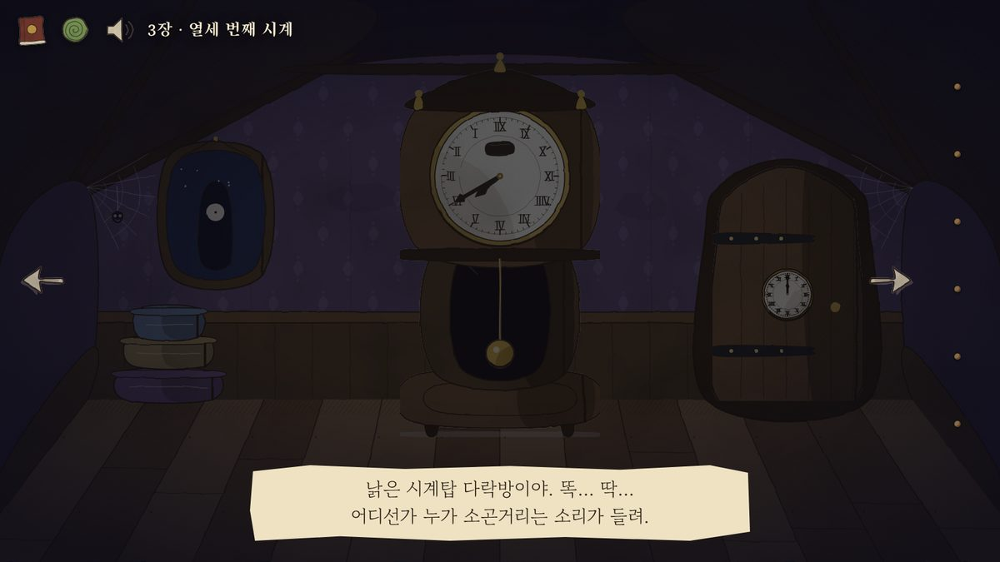 | 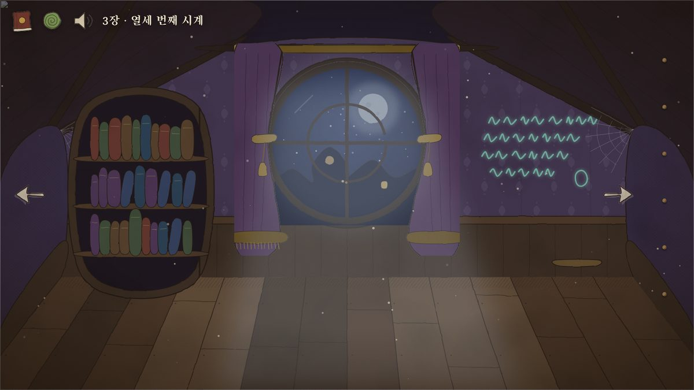 | 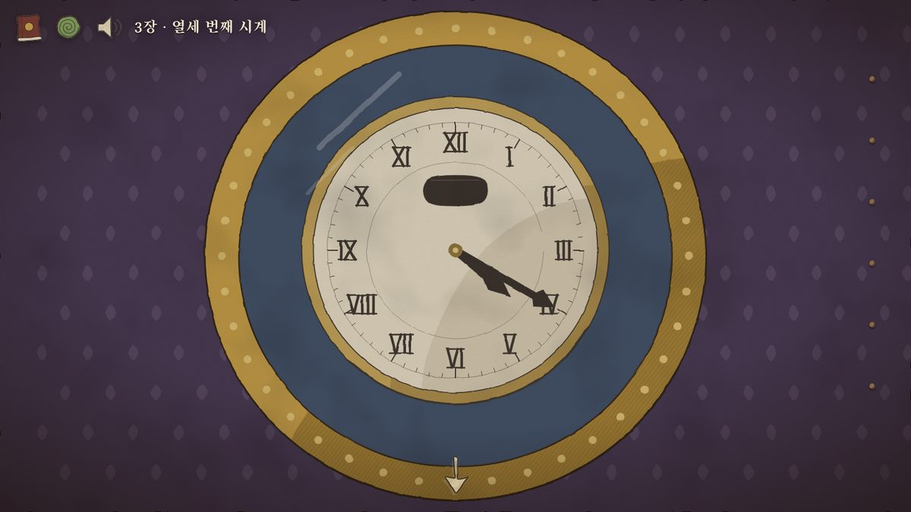 | 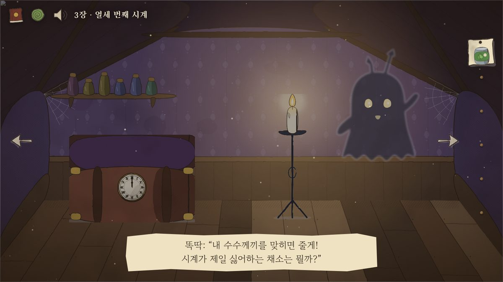 |

**4장 거꾸로 된 세상 · 5장 바닷속 우체국**

| 거꾸로 된 방 | 레버를 당긴 뒤 | 문어 우체국장 팔방이 | 창밖의 고래 |
|---|---|---|---|
| 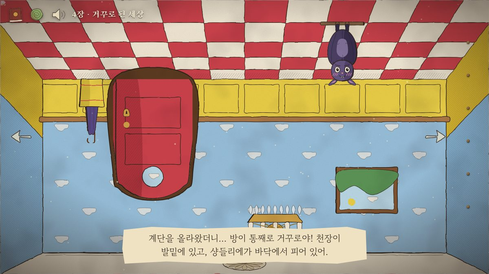 | 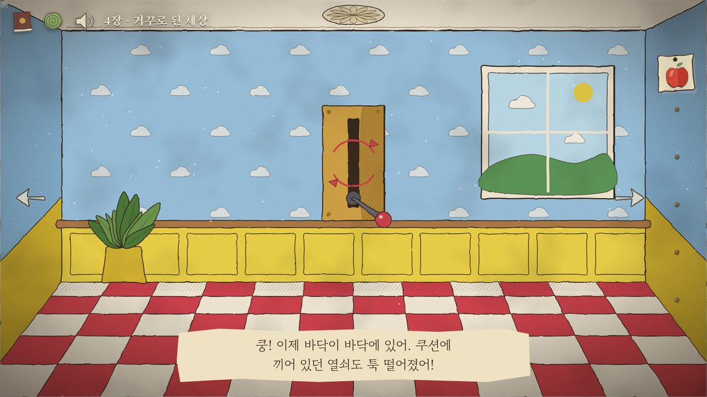 | 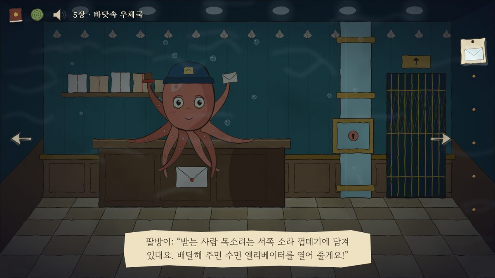 | 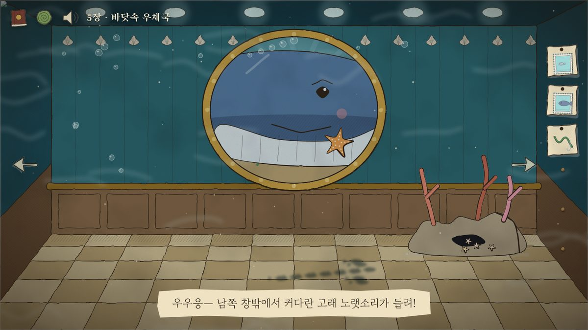 |

## 지금 상태

| 장 | 제목 | 분위기 | 상태 |
|---|---|---|---|
| 1장 | 햇살이 멈춘 온실 | 밝고 따뜻한 | **플레이 가능** (처음부터 탈출까지) |
| 2장 | 토끼의 장난감 공방 | 귀엽고 아기자기한 | **플레이 가능** (처음부터 탈출까지) |
| 3장 | 열세 번째 시계 | 은은하게 오싹한 | **플레이 가능** (처음부터 탈출까지) |
| 4장 | 거꾸로 된 세상 | 기발하고 초현실적인 | **플레이 가능** (처음부터 탈출까지) |
| 5장 | 바닷속 우체국 | 신비롭고 몽환적인 | **플레이 가능** (처음부터 탈출까지) |
| 6장 | 거인의 책상 | 아기자기하고 놀라운 (내가 작아졌다!) | **플레이 가능** (처음부터 탈출까지) |

## 실행하기

빌드 과정이 없습니다. `index.html`을 브라우저로 열면 바로 됩니다.

로컬 서버로 열고 싶다면:

```bash
npx serve .
```

GitHub Pages로 공개하기 (가벼운 WebP 판):

1. 처음 한 번만: 저장소 Settings → Pages → Source를 **Deploy from a branch**, Branch를 **gh-pages** / **(root)** 로 고르고 Save.
2. 게임을 고친 뒤에는 `npm run pages` 한 번이면 `gh-pages` 브랜치가 새로 올라가고, 1~2분 뒤 사이트에 반영됩니다.

주소: https://jbhee7777-afk.github.io/paperdoor/

개발할 때는 `index.html#play-greenhouse` 로 열면 표지를 건너뛰고 1장으로 바로 들어갑니다.

## 조작

- 위쪽 나침반이 지금 보는 벽(북·동·남·서)을 알려 줌
- 왼쪽 위 도구: 책(표지로) · 달팽이(3단계 힌트) · 돋보기(누를 수 있는 곳이 잠깐 반짝) · 수첩(중요한 대사·단서 다시 보기) · 소리
- 방 안의 물건을 눌러 조사하거나 줍기
- 좌우 화살표(또는 키보드 ← →)로 벽 돌기, 확대 화면에서는 아래 화살표(또는 Esc)로 돌아가기
- 가방(오른쪽 꼬리표)에서 아이템을 하나 고르고 방 안 물건을 누르면 그 아이템을 사용
- 아이템을 고른 채 다른 아이템을 누르면 조합, 같은 아이템을 한 번 더 누르면 자세히 보기
- 왼쪽 위 달팽이 껍데기(또는 방 안의 달팽이)를 누르면 3단계 힌트

## 폴더 구조

```
index.html              게임 진입점
css/game.css            화면 스타일
js/engine.js            포인트 앤 클릭 엔진 (방 데이터를 읽어서 그림)
js/audio.js             효과음 (Web Audio 합성, 파일 없음)
js/rooms/greenhouse.js  1장 방 데이터: 오브젝트 배치, 퍼즐, 힌트
js/rooms/toyshop.js     2장 방 데이터 (그림자 인형극·오르골 위젯 포함)
js/rooms/clock13.js     3장 방 데이터 (트렁크 시계 자물쇠 위젯 포함)
js/rooms/upside.js      4장 방 데이터 (방 전체가 180도 뒤집힘)
js/rooms/sea.js         5장 방 데이터 (우편함 번호 위젯 포함)
js/rooms/desk.js        6장 방 데이터 (작아진 나, 그림자 X, 종이배)
js/main.js              표지·장 선택
assets/rooms/<방>/      bg(배경) · props(소품) · items(아이템) · zoom(확대 화면)
assets/ui/              화살표, 꼬리표, 아이콘
tools/art/*.mjs         SVG 에셋 생성기 (손그림 질감 필터 포함)
tools/playtest*.js      자동 플레이 테스트 (1~5장 탈출 + 튼튼함 검사)
tools/build-raster.js   배포용 WebP 굽기 (npm run build → dist/)
assets/fonts/           내장 글꼴 (SIL OFL)
docs/                   아트 디렉션, 퍼즐 설계, 에셋 목록, 로드맵
```

## 그림 다시 그리기 / 테스트

```bash
node tools/art/greenhouse.mjs
```

```bash
node tools/art/toyshop.mjs
```

```bash
node tools/art/clock13.mjs
```

```bash
node tools/art/upside.mjs
```

```bash
node tools/art/sea.mjs
```

```bash
node tools/art/ui.mjs
```

```bash
node tools/art/desk.mjs
```

```bash
node tools/art/frames.mjs
```

```bash
node tools/art/blink.mjs
```

```bash
npm install && npm run playtest
```

```bash
npm run build
```

`build`는 모든 SVG를 WebP 그림으로 구워 `dist/`에 가벼운 배포본을 만듭니다 (학교 크롬북·저가 태블릿용). `dist/index.html`을 열거나 `dist` 폴더를 통째로 올리면 됩니다.
글꼴은 `assets/fonts/`에 들어 있어 인터넷이 막혀도 같은 글꼴로 보입니다 (다시 만들기: `tools/subset-fonts.py`).

`playtest`는 Playwright로 1~5장을 처음부터 끝까지 실제로 클릭해 보고, 단계별 스크린샷을 `screenshots/playtest/`, `screenshots/playtest-2/`, `screenshots/playtest-3/` … `playtest-5/`에 남깁니다. 마지막으로 `playtest-resilience.js`가 연출 도중 새로고침, 가방이 꽉 찬 경우, 휴대폰·태블릿 화면을 검사합니다.
개발할 때는 `index.html#play-toyshop`(2장), `index.html#play-clock13`(3장), `#play-upside`(4장), `#play-sea`(5장), `#play-desk`(6장)으로 바로 들어갈 수 있습니다.

## 문서

- [docs/ART_DIRECTION.md](docs/ART_DIRECTION.md) — 그림 스타일, 방별 팔레트, 금지 사항
- [docs/PUZZLE_DESIGN.md](docs/PUZZLE_DESIGN.md) — 다섯 방의 퍼즐 흐름
- [docs/ASSET_LIST.md](docs/ASSET_LIST.md) — 에셋 파일명·해상도·투명 여부·이미지 생성 프롬프트
- [docs/ROADMAP.md](docs/ROADMAP.md) — 다음에 할 일
- [CLAUDE.md](CLAUDE.md) — Claude Code로 이어서 작업할 때 읽는 안내서
